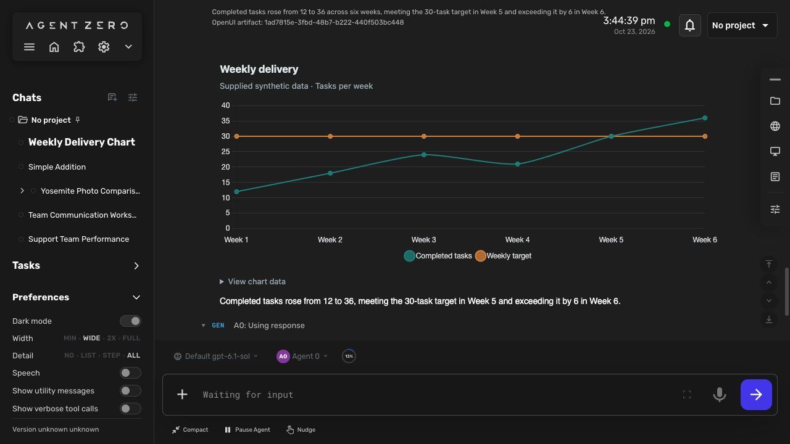

# OpenUI for Agent Zero

Interactive answers and designed email drafts in the existing Agent Zero chat. This community plugin uses the official OpenUI React renderer in a local sandbox.



**Gateway is optional.** The default uses Agent Zero's configured model and does not make a second model call just to render an answer. No OpenUI account is required. Your chosen model may have its own charges or subscription; a local model can be configured through Agent Zero, but local-model quality has not been benchmarked for this release.

## Included

- **103 general UI components:** cards, text/Markdown/code display, tables and editable tables, all upstream chart families, tabs, accordions, steps, carousels, modals, composed cards, icons and image references, and rich form controls.
- **ImageCard, ImageCarousel and ImageGrid:** image results with accessible alt text, source-page attribution, manual carousel navigation and graceful missing-image fallbacks.
- **Chart.js 4.6.1**, bundled locally: bar, line, area, pie, doughnut, radar, polar area, scatter and bubble, plus mixed bar/line series; each chart has an accessible data table. Upstream charts remain available.
- **Dashboard and DashboardSection**, metrics, progress, facts, timeline, task boards, comparisons, agendas, resource lists, status labels, quotes, checklists and ratings.
- **ComponentTemplate:** reusable presentation layouts assembled on demand from OpenUI components, with scalar parameters.
- **44 React Email components:** email layouts, headings, text, links/buttons, headers/footers, feature blocks, statistics, pricing, checkout, testimonials and galleries.
- An **Email studio** with Draft / Connected inbox views, editable To/Cc/Bcc and subject, rich/plain-text previews, mobile-width preview, HTML/text export, and **Review & send**.
- **Connected inbox** reuses enabled IMAP accounts in Agent Zero's Email Integration. Search the Inbox, preview a selected message, and draft a reply with its actual account, reply address and thread subject.
- Saved form state and follow-up buttons routed through Agent Zero's normal chat send path.
- Ordinary text summaries, source inspection, copy, and an explicit **Repair** action.

General UI has a separate HTTPS-image renderer. ImageCard/ImageCarousel/ImageGrid use actual search-result or user-supplied HTTPS image URLs, omit image-request credentials and referrers, reject literal local addresses, and fall back to alt text and the source link if embedding fails. Some providers block cross-origin images. Source URLs document provenance, not licensing permission. Email previews continue to block remote images. The renderer makes no image proxy requests through Agent Zero and does not download or persist remote images. Clicking an HTTP/HTTPS link opens a separate browser tab without opener access or a referrer; non-web links and URLs containing credentials are rejected. Email HTML can retain user-supplied image/link URLs, which may load when the exported document is opened elsewhere. Generated source cannot access the parent page, credentials, JavaScript network APIs or arbitrary Agent Zero tools. The visual renderer allows HTTPS image requests; the email renderer does not. Password input and model-supplied regular-expression validators are excluded. General forms are for task preferences and ordinary data, not credentials.

The component count describes the available library. Representative rendering and interaction tests do not establish every possible component combination or compatibility with every email client.

## Install

Download the ZIP from [Releases](https://github.com/TerminallyLazy/a0-openui/releases), then upload it in Agent Zero's **Plugins → Install Plugin → ZIP** flow. The supplied thumbnail is included unchanged at `thumbnail.png` and `webui/thumbnail.png`. Built assets and generated prompts are included; end users need no Node/npm, extra Python packages, hosted renderer or paid OpenUI account. Enable the plugin for the desired agent using normal plugin activation. Restart Agent Zero when its installer requests it, and reload the browser after an update.

For development, the plugin lives at `/a0/usr/plugins/openui/`. A standalone distribution places `plugin.yaml` at its root. Do not copy it into bundled `plugins/` unless intentionally promoting it to a bundled plugin.

The install hook validates the shipped checksums. It does not download packages. Missing or mismatched assets require a rebuilt/reinstalled release. Uninstall stops active UI generation and leaves chat-owned artifacts and text summaries intact. Normal chat deletion removes their persisted data.

## Use

With the plugin enabled, ask normally. Agent Zero is instructed to choose an interface automatically when the task benefits from one; you do not have to mention OpenUI or choose the component. For example:

> How is the team doing? Here are our daily figures and target.

> Compare these photographs and keep their source links.

> Help plan a workshop. Get my preferences before proposing a schedule.

> Create a React Email newsletter draft using only these facts, and let me download its HTML. Do not send it.

The agent selects `surface: "ui"` or `surface: "email"`. The two surfaces use different generated component contracts. Email uses `EmailTemplate` as its root; general UI uses `Stack`.

Selection guidance maps image results to sourced cards/carousels/grids; related metrics to dashboards and charts; options to aligned comparisons; multiple missing preferences to compact validated forms; and plans to agendas/timelines with optional details. Short factual replies, acknowledgments and explicit plain-text requests stay text. The agent searches with existing permitted tools when the task needs it, then presents actual results. The presentation choice grants no new tool or sending authority. Selection is model-driven guidance, not a deterministic guarantee across every model or prompt.

The Material UI and shadcn examples inform composition, including chart tabs, expandable details, consistent card structure and working form submissions. Four original syntax-checked examples are shared by the main agent reference and both generation prompts. They use this plugin's exact component signatures; the demo libraries have different roots, props and execution capabilities and cannot be pasted verbatim. No extra design framework or paid service is installed.

**Use current answer (streams, no extra call)** now previews the OpenUI program as it arrives in the main model's tool arguments. This makes no additional model call. Controls, form submission and email review/send stay disabled until the complete tool call is validated and executed; the same preview then becomes the saved artifact. Stopping generation preserves an interrupted, non-interactive preview. Providers that buffer arguments, calls without an explicit early surface, and unsupported/multiple-call envelopes fall back to ordinary completion. The agent is instructed to emit surface/title/summary before program. Native Responses argument deltas and Chat Completions JSON text are supported through the existing stream hook. Previewing never executes partial tools or changes model history.

**Generate separately (streams, extra model call)** remains available when a separate generation pass is wanted, using the selected main or utility model. It makes an additional UI-generation call. **OpenUI Gateway** remains optional.

OpenUI appears inside the existing tool step. Expand the step to interact. The agent finishes through the usual response tool. Buttons with `@ToAssistant` send a visible message including the submitted values and artifact reference. The composer draft and unrelated attachments are preserved. Repeated rapid clicks are suppressed; intentional retries are allowed.

## Cards, dashboards, forms and reusable layouts

Image searches and visual recommendations should produce sourced image cards, carousels or grids automatically when image URLs are available. Agent Zero searches with its existing tools, then passes actual image URLs, alt text and source-page links into the visual components. If no image URL is available it can present sourced text cards. No separate paid search or Gateway account is required by this plugin.

`ComponentTemplate(name, program, values)` lets the agent compose a new presentation component during a normal answer. `program` is a quoted OpenUI program rooted at `Stack`; `@Prop("key", fallback)` reads a supplied string, finite number or boolean. Reuse the same program variable with different values. Templates persist in the artifact source and can be copied into later programs; they are not global installed React components. They support presentation cards, images, Chart.js, metrics and the new informational components. Forms/actions stay in the main program. Templates cannot nest templates, execute JavaScript, access tools or add dependencies. Each template is bounded to 8,192 characters, 40 parameters and the enclosing artifact's 64 KiB limit.

Chart data is limited to 12 series and 500 points per series. No executable Chart.js callbacks or plugins are accepted. Animation is disabled. Image collections support up to 24 entries and never auto-play. Dashboards collapse to one column at narrow widths. Forms keep the existing state-save, validation and normal chat-submission path.

See [the component catalog](generated/components.md) for exact signatures and a reusable-template example.

## Connected email

Connect the mailbox in Agent Zero's existing **Email Integration**, then choose **Connected inbox** in an expanded email draft. Select a mailbox, optionally search, load recent messages, and select one. **Draft a reply** asks the current agent to read that message and create a new OpenUI email draft. The new draft shows its actual From/To addresses and original subject. Credentials stay in the owning integration.

The agent can also use `openui_mail` to list accounts, search Inbox headers, or read a selected message when requested. Its tool policy and the current OpenUI chat/profile still apply. The reader uses a read-only Inbox selection and `BODY.PEEK`, respects the configured sender whitelist, and leaves read flags, polling cursors and attachments untouched. It does not start polling or change the existing integration's reply automation.

Search covers the most recent 5,000 Inbox UIDs, with 1–20 returned headers. A selected raw message is limited to 256 KiB, and body text to 12,000 UTF-8 bytes with a visible truncation flag. HTML mail has a sanitized rich preview with a plain-text switch. Only bounded plain text is returned to the model tool; the native mailbox view receives HTML. Scripts, forms, embedded content, unsafe links and CSS URLs are removed. Inline layout, typography, colors, tables and safe links remain; custom style blocks are removed, so complex provider layouts may simplify. Rich HTML is limited to 128 KiB, with plain-text fallback for larger HTML parts. Remote images and attachments are not fetched. Message references bind account, UIDVALIDITY and UID; a changed mailbox requires a refresh. Reply metadata is bound to a read by the same active agent/profile, rather than accepted from model-supplied addresses. Selected content enters ordinary chat history when the user requests an agent draft and uses that agent's configured model.

This release supports IMAP accounts, including the live-verified Gmail connection. Exchange-only accounts and arbitrary Gmail/Outlook MCP connectors need their own reader adapters; they are not silently treated as IMAP. Provider-side draft saving, attachments, archiving, deleting and marking read are not implemented. OpenUI uses SMTP for explicitly reviewed sending; it does not append to an IMAP Sent folder, and whether a sent copy appears there depends on the provider.

## Review and send rich email

In **Draft**, select a connected From account and review To, optional Cc/Bcc, and subject. Recipient/subject edits persist in this artifact's form state. To change the designed body, ask the agent to revise the draft; the preview is not a freeform HTML editor. Choose **Review & send** to see the exact server-prepared recipients, subject and sanitized rich/plain-text content. **Send email** is a separate final action. Closing the review sends nothing. Reviews expire after ten minutes and are bound to the current artifact source, revision, agent/profile and sending account.

Sending reuses the existing Email Integration SMTP host, port, username and password. It sends `multipart/alternative` plain text plus formatted HTML over verified TLS (implicit TLS on port 465; STARTTLS otherwise). Bcc is envelope-only. A reply retains a valid original Message-ID for threading. No extra provider subscription or Gateway is needed. SMTP acceptance is reported separately from final delivery; partial refusals and uncertain outcomes are visible.

The generated UI and `openui_mail` model tool cannot invoke this send API. Authenticated native host controls prepare the message and submit its one-use review token under normal CSRF checks. An exclusive, durable receipt is written before SMTP. Repeat clicks, HTTP retries and reloading the same artifact cannot submit it again. An interrupted or uncertain send stays locked; check the provider before creating a new draft. There is no automatic retry. This protection applies to the same artifact on this installation, not to newly generated copies, deleted receipt files or separate installations.

Private receipts live under `/a0/usr/openui/deliveries/`, outside chat snapshots, with the submitted content and outcome. They survive chat time travel and deletion to preserve duplicate protection; deleting a chat does not delete these receipts. They contain no account password, and are not shipped in the plugin archive. Prepared-but-unsent content is held only in memory. Review tokens expire after ten minutes; expired entries are discarded on the next preparation or server restart. After acceptance the workspace displays the frozen submitted email and receipt. Existing integration polling and automatic-reply behavior are unchanged.

## Generation settings

| Mode | Behavior |
| --- | --- |
| **Use current answer (streams, no extra call)** (default) | The main agent streams its OpenUI program through the ordinary tool call. No extra inference just for rendering. |
| **Generate separately (streams, extra model call)** | A separate call to the selected Main or Utility model progressively renders the program. Uses the existing provider configuration and adds model usage. |
| **OpenUI Gateway** (optional) | Explicit server-side Gateway generation. Requires user configuration and may incur charges. Never a silent fallback. |

Gateway configuration uses `THESYS_API_KEY` in the server environment and a provider/model in plugin settings. Do not put credentials in tool arguments, frontend files or chat. Gateway has not been live-tested in this release. No auto-fix subscription or cloud telemetry is enabled. The optional provider is not involved in default rendering, forms, email export or explicit repair.

## Storage and limits

Programs live in chat data, not in log content. Logs contain only bounded descriptors. The normal tool completion handler can replace log text without losing the artifact. Chat export/import preserves the program and saved state. Delivery receipts are local to this installation and are not exported in chat snapshots. Access checks require the existing chat, linked log, matching active agent profile, enabled plugin and current tool policy.

Per artifact: 64 KiB program, 8 KiB form state, 16 KiB generation data, 200-byte title, 1,200-byte summary. Per chat: at most 32 artifacts and 1 MiB total artifact data. Oversized input is rejected rather than truncated. Source and state revisions prevent stale edits. The prior UI v2 and email v1 contracts remain supported unchanged. Previous UI v3 snapshots use the current renderer, including the corrected ImageGrid schema. Reopening a chat reloads the authorized snapshot into a fresh renderer connection. Unknown library digests show a fallback and require regeneration. Entries outside Agent Zero's retained log window cannot be reopened through the artifact API.

Generation interruption retains bounded partial source. Incomplete or failed artifacts cannot submit actions. User-visible errors use normal Agent Zero notifications. Repair is an explicit new conversation request, with ordinary model usage.

## Development

Build from the plugin root:

```sh
cd /a0/usr/plugins/openui/frontend
OPENUI_TELEMETRY_DISABLED=1 npm ci --ignore-scripts
OPENUI_TELEMETRY_DISABLED=1 npm run build
npm run typecheck
npm test
```

The build produces both library specs, direct/Gateway prompts, tool references, a production renderer and a checksum manifest. Commit/release source, lockfile and generated assets together in a standalone plugin repository. Do not distribute `node_modules`, credentials, runtime config or caches. Full production dependency notices are included in `generated/third-party-notices.txt`; the renderer also ships its linked legal notices. A pinned KaTeX patch addresses the advisory in the upstream dependency range. React Email's current package uses deprecated primitive packages; their installed compatibility is covered by rendering/export tests, and updates should track upstream.

Backend checks run from the Agent Zero root using its **framework** interpreter and test dependencies (including `pytest-asyncio` for the mailbox tests):

```sh
/opt/venv-a0/bin/python -m pytest usr/plugins/openui/tests -q
```

The browser host uses normal `get_tool_message_handler`, authenticated/CSRF-protected plugin APIs, and `sendMessage`. No core agent, initializer, transport or chat-shell changes are required.

## Current boundaries

- Query/Mutation adapters and direct tool execution from generated UI are not exposed.
- Alternative MUI/shadcn shells, Handsontable, unrestricted HTML artifacts and other agent harnesses are not bundled. They require separate compatibility, permission and licensing decisions.
- This is an early community release. See [validation and limitations](VALIDATION.md) for the tested framework, component coverage and live checks. Compatibility with every Agent Zero version, model and email client is not established. Community index inclusion requires maintainer approval.

Upstream: [OpenUI](https://github.com/thesysdev/openui), [React Email integration](https://www.openui.com/integrations/react-email), [renderer documentation](https://www.openui.com/docs/openui-lang/renderer).

## Composition references

- [Material UI example library and prompt](https://github.com/thesysdev/openui/blob/main/examples/design-systems/material-ui/src/lib/mui-genui/index.tsx): validated forms, chart tabs and details.
- [shadcn example library and prompt](https://github.com/thesysdev/openui/blob/main/examples/design-systems/shadcn/src/lib/shadcn-genui/index.tsx): consistent carousel structure and progressive disclosure.
- [Open Intelligent UI](https://github.com/thesysdev/open-intelligent-ui) and [F1 dashboard](https://github.com/thesysdev/openui-f1-dashboard): task-appropriate presentation, primary visual with supporting evidence, and useful follow-ups.
- [API reference](https://www.openui.com/docs/api-reference), [demos](https://www.openui.com/demos), and [coding-agent MCP documentation](https://www.openui.com/docs/mcp). The MCP page describes documentation access through Context7; it is not an additional runtime requirement.

References were reviewed as source examples, without scaffolding another application or copying their model/account settings.

## License and attribution

The plugin is MIT licensed. Agent Zero notices are preserved for derived portions; bundled OpenUI, React Email, Chart.js and other dependencies retain their respective licenses in [third-party notices](generated/third-party-notices.txt). This repository is maintained by TerminallyLazy and is not an official Agent Zero or OpenUI product.
